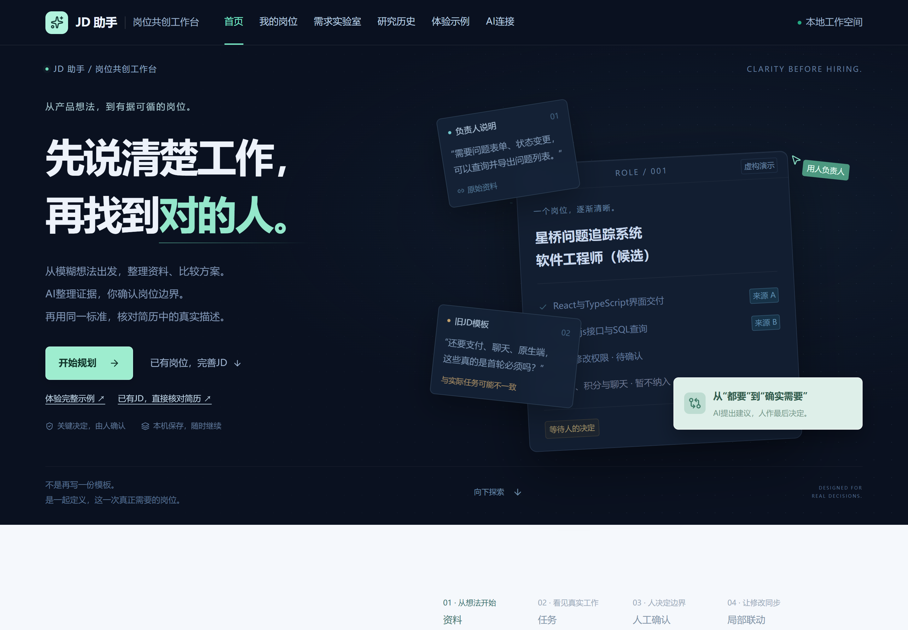
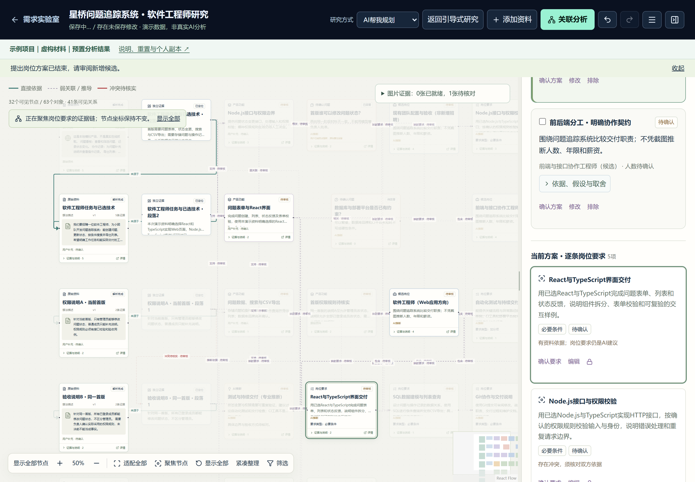

# JD 助手 · 从产品想法到岗位与简历证据

面向缺少技术招聘经验的小团队，把一句产品想法、参考材料和人工决定，逐步整理为有依据的岗位需求与可编辑JD。AI提出候选，程序校验结构与引用，人决定是否采纳。



## 主要功能

- **需求实验室**：“AI帮我规划”和“和AI一起研究”共享资料、证据、问题与方案。支持有效业务选项、自定义回答、未知及暂缓。
- **交互证据板**：来源、证据、功能、推断、问题、岗位及要求可追溯；支持证据链聚焦、缩放、增量布局、标注和撤销。
- **岗位共创**：任务与要求分别确认，JD按内容块组织，局部修改先预览差异；锁定和版本检查保护人工编辑。
- **研究快照与导入**：自动保存草稿、不可变快照、部分导入、上游差异提示及JSON/Markdown导出。
- **简历证据核对**：沿用岗位标准，浏览器解析PDF/DOCX；引用定位原文，保留“未体现，待核实”，不作录用或淘汰决定。



## 快速开始

已验证环境：**Node.js 24.14.1、pnpm 12.15.0**。精确依赖保存在 `pnpm-lock.yaml`，版本和职责见[依赖清单](docs/dependencies.md)。没有额外Python、Java、Express、GPU或云数据库要求。

在Windows PowerShell执行：

```powershell
git clone https://github.com/ccsxIsMe/jd-assistant-showcase.git
Set-Location -LiteralPath '.\jd-assistant-showcase'
pnpm install --frozen-lockfile
Copy-Item -LiteralPath '.env.example' -Destination '.env.local'
pnpm dev
```

默认地址 **http://127.0.0.1:3000**。已有 `.env.local` 时保留它；复制示例仅用于全新克隆。若pnpm不在PATH，使用本机实际的pnpm命令路径。依赖安装会准备PDF.js本地资源；已有依赖时可单独运行 `pnpm prepare:pdf`。

生产方式：`pnpm build` 后运行 `pnpm start`；更换空闲端口使用 `pnpm dev --port 3004`。同一工程已有开发服务时使用已有地址，避免重复启动冲突实例。完整说明见[环境配置](docs/environment.md)。

## 直接体验展示案例

打开 **/examples**，使用“星桥问题追踪系统 · 软件工程师研究”。每个模块有“从头体验”和“查看完成版”，支持安全重置及个人副本。

**所有案例资料、简历和预置响应均为虚构演示数据，不是真实AI分析。** 演示走正式的保存、引用校验、快照、导入、采纳与撤销流程，不消耗模型调用。普通新岗位可手动整理；预置答案不覆盖任意行业或任意修改意图。

[五至八分钟展示脚本](docs/demo-guide.md)：资料 → 方案与决定 → 证据板 → 快照及部分导入 → 确认任务 → 生成JD → 局部修改 → 简历原文核对。

## AI配置

新克隆默认 `mock`，无需API Key即可展示。真实模式由网站前端请求本项目Route Handlers，再由服务端请求DeepSeek，不依赖外部聊天页面。

```dotenv
AI_MODE=mock
DEEPSEEK_API_KEY=
DEEPSEEK_BASE_URL=https://api.deepseek.com
DEEPSEEK_MODEL=deepseek-flash
```

真实使用时，仅在本机根目录 `.env.local` 填写密钥并设 `AI_MODE=real`，重启服务，再主动操作。密钥不使用 `NEXT_PUBLIC_` 前缀，不进入前端、浏览器存储、快照或仓库。真实失败明确报错，不静默切回预置。模型名称与服务商可用性以实际配置为准。

`pnpm test:connection`、`pnpm test:suggestion`、`pnpm test:live` 涉及真实模型服务，需自己明确决定是否执行。普通单元和浏览器回归使用mock，不需要密钥。

## 技术架构与目录

React 19 / Next.js 16 App Router / TypeScript strict / Tailwind CSS / shadcn源码组件；AI SDK＋DeepSeek Provider＋Zod；React Flow；PDF.js、Mammoth；IndexedDB＋Blob本机持久化。

```text
src/app/                 页面与服务端API
src/components/          公共UI、教程及业务交互
src/lib/ai/              模型适配、提示词、JSON/范围校验
src/lib/lab/             图谱、关系、标注与操作
src/lib/workbench/       岗位任务、JD和局部审阅
src/lib/decisions/       统一决定、选项与答案版本
src/lib/storage/         IndexedDB持久化
src/lib/demo/            明确标识的虚构案例
public/demo/             可重复解析的演示文件
tests/                   单元、浏览器与显式真实联调
docs/                    架构、环境、测试与展示说明
```

[系统架构与AI流程](docs/architecture.md) · [结构化任务样例](docs/ai-tasks/) · [环境与依赖](docs/environment.md) · [简历证据设计](docs/resume-evidence.md)

## 测试与代码规范

```powershell
pnpm lint
pnpm typecheck
pnpm test
pnpm build
pnpm check:public
```

浏览器回归默认使用本机Edge，先启动mock生产服务再运行 `pnpm test:e2e`，具体命令和本次实际结果见[测试记录](docs/verification.md)。Playwright会在请求模型前检查服务端处于mock。ESLint、Prettier、严格TypeScript保持启用，不通过忽略构建错误制造成功。

## 数据与能力边界

资料按当前浏览器、域名和端口隔离。清除站点数据会丢失本机内容，请导出备份；没有账号系统、跨设备同步或多人实时协作。PDF/DOCX主要提取文字；图片识图需要真实模型和人工校对，本地视频由用户选择关键帧，视频网址只获取可访问的网页文字。未实现扫描件OCR、音频转写和旧 `.doc`。

模型结果通过结构、引用、锁定与版本校验，仍需人判断内容是否适用。简历发送外部AI前须主动确认。详细安全边界与打包清单见[公开代码说明](docs/public-release.md)。

## 团队与Git记录

维护账号：**[ccsxIsMe](https://github.com/ccsxIsMe)**。其他成员、学校及指导教师信息未提供，未自行编造。

这是当前本机项目的独立脱敏展示副本。原仓库在整理时没有任何Git提交，因而不存在可恢复的早期开发历史。本仓库仅保留从本次真实整理开始的提交，不补造日期或开发记录；详见[发布记录](docs/public-release.md)。
