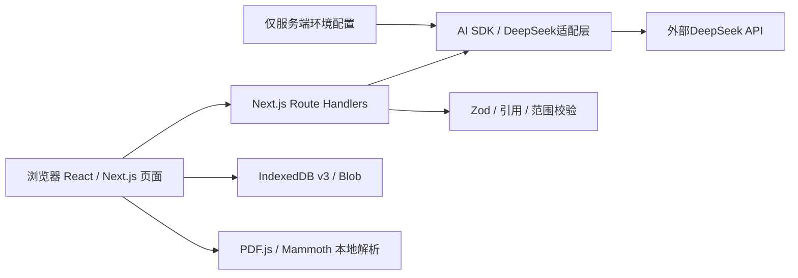
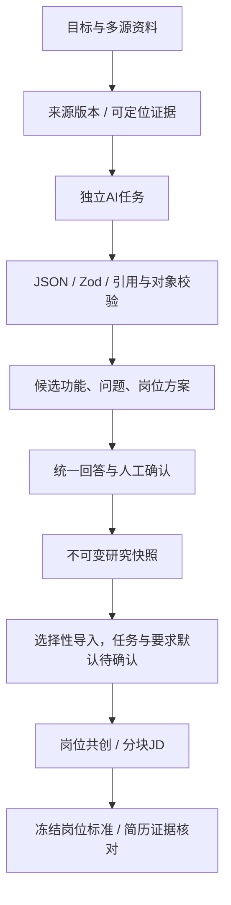

# 当前系统架构

页面请求项目API，浏览器不持有模型密钥。App Router承担前后端入口，没有第二套Python/Express服务。业务状态主要位于浏览器，服务端负责输入、模型调用和结果校验，不存在已实现的云端业务数据库。

## 需求研究与岗位闭环

两种研究模式共用 `Exploration/lab`，模式与画布筛选属于视图组织，不重建业务数据。来源、证据、功能、推断、问题、岗位和要求具有稳定ID，来源属性与确认状态分开。强关联需直接可定位证据，冲突保留双方依据。

## AI任务与保护机制

岗位侧拆分extractRequirements、inspectIssues、generateJdDraft与proposeLocalChanges；研究侧拆分功能提炼、跨资料关联、岗位方案与按需图像证据提取。各自维护Schema、提示词、JSON样例和promptVersion，共用服务端适配层。

材料作为不可信数据，不能覆盖系统指令。结构合法后继续验证来源原文、对象ID、允许范围、锁定和版本；模型不能授予确认状态或直接写数据库。结构化候选完成校验后才作为结果展示；失败明确报错，有限修复不等于放宽证据约束。

局部建议先生成差异，人选择采纳后才修改。请求绑定相关对象版本，迟到或过期结果不能覆盖新编辑；对象级撤销检查后续修改，不回滚无关内容。确认、排序、锁定和保存由代码完成，不调用模型。

## 持久化

同一IndexedDB v3包含workspaces、explorations、exploration-assets、resume-reviews和demo-instances。Blob资产与结构状态分开保存。草稿自动保存用于恢复编辑，手动快照是不可变历史版本；下游岗位保留来源快照并独立编辑，上游更新只显示差异。

示例模式使用显式预置响应，同样经过业务校验，页面与导出标识演示数据。真实模式缺配置、超时或引用错误时不回退预置。公开配置样例不包含凭据。
